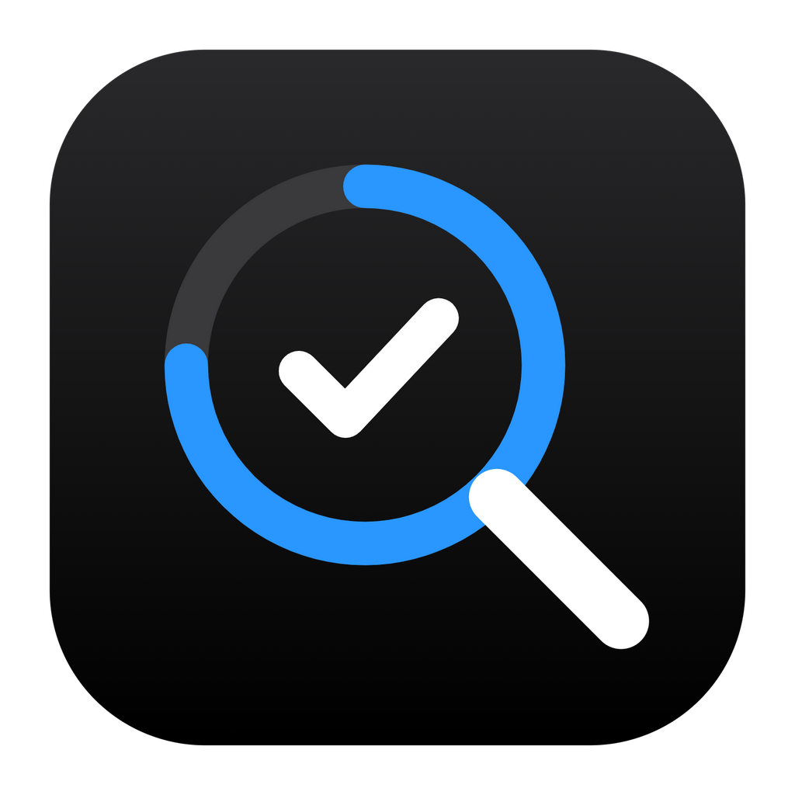
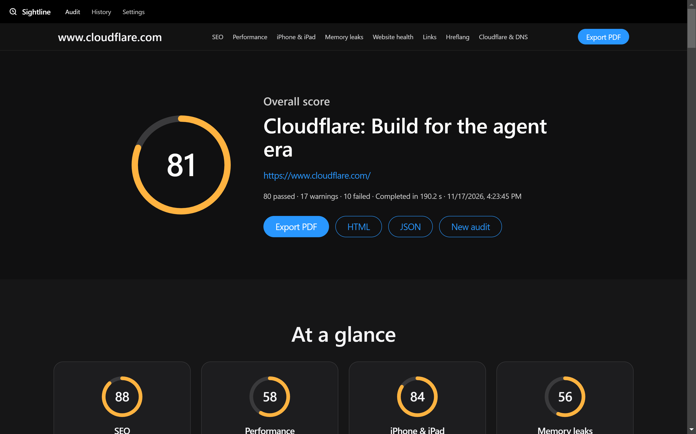

<div align="center">



# Sightline

**Every detail. Audited.**

Free, open-source **website audit tool** — SEO audit, Lighthouse-style scores, Core Web Vitals, accessibility, broken links, hreflang, code coverage, **memory leak detection**, iPhone/iOS Safari testing and Cloudflare checks in **one app**.

[](https://github.com/Zubair-hussain/Sightline/actions/workflows/ci.yml)
[](https://github.com/Zubair-hussain/Sightline/actions/workflows/codeql.yml)
[](LICENSE)


[Download](https://github.com/Zubair-hussain/Sightline/releases/latest) · [Features](#-what-it-checks) · [AI apps (MCP)](#-use-it-from-ai-apps-mcp) · [CLI](#-command-line--ci) · [Discussions](https://github.com/Zubair-hussain/Sightline/discussions)



</div>

## Why Sightline?

Launching a website usually means juggling Lighthouse, an SEO crawler, a broken-link checker, an hreflang validator, DevTools memory snapshots, a real iPhone and your Cloudflare dashboard. **Sightline runs all of it in one click** and explains every finding in plain language, with a fix — so marketers, founders, QA testers and developers can all use it.

- 🆓 **Free & open source** (MIT) — no account, no limits in the desktop app
- 🔒 **Private** — audits run on your computer
- 🧑‍💼 **No code needed** — every check says *what's wrong, why it matters, how to fix it*
- 🎨 **Client-ready PDF reports** styled in the audited site's own brand colours, fonts and logo
- ✅ **Launch-day test plan** generated from every audit — export to Excel, Markdown or Playwright
- 🌍 **14 languages**, including right-to-left Arabic and Urdu

## 🔍 What it checks

| Audit | Highlights |
|---|---|
| **Lighthouse-style scores** | Performance, Accessibility, Best Practices and SEO scores (0–100) on a throttled mobile or desktop profile, using Lighthouse's published scoring curves, Speed Index and **axe-core** accessibility rules |
| **SEO audit** | Title, meta description, headings, canonical, robots.txt, noindex, XML sitemap, structured data (JSON-LD), Open Graph, duplicate titles across a site crawl |
| **Core Web Vitals** | LCP, FCP, CLS, TBT, TTFB, page weight, JavaScript size, console errors — measured in a real browser |
| **Code coverage** | Unused JavaScript and CSS per file, like the Chrome DevTools Coverage tab |
| **Broken link checker** | Every `<a href>`: 404s, redirect chains, empty and `javascript:` links, missing link text, unsafe `target=_blank` |
| **Hreflang validator** | ISO language/region codes, x-default, self-reference, and **return tags** verified on every language version |
| **Memory leak detector** | Uses the page repeatedly and tracks JS heap, DOM nodes, event listeners, timers and detached nodes — automatic or with your own steps, always behind a safety confirmation |
| **iPhone & iPad (iOS Safari)** | 44 pt tap targets, input auto-zoom, safe areas / Dynamic Island, `100vh`, touch icon, manifest, Universal Links — with a device screenshot |
| **Website health & security** | HTTPS, TLS certificate expiry, HSTS, CSP, clickjacking, cookies, compression, caching, HTTP/3, mixed content, accessibility basics |
| **Cloudflare & DNS audit** | Proxy detection, edge caching, minimum TLS, Always Use HTTPS, origin IP exposure, DNSSEC, CAA, SPF/DMARC, optional API zone-settings review |

## ⬇️ Download

| Platform | Get it |
|---|---|
| **Windows 10/11** | [`Sightline-Setup-x64.exe`](https://github.com/Zubair-hussain/Sightline/releases/latest/download/Sightline-Setup-x64.exe) |
| **macOS 11+** (Apple Silicon & Intel) | [`Sightline-mac-universal.dmg`](https://github.com/Zubair-hussain/Sightline/releases/latest/download/Sightline-mac-universal.dmg) |
| **Linux** | [AppImage](https://github.com/Zubair-hussain/Sightline/releases/latest/download/Sightline-linux-x86_64.AppImage) · [.deb](https://github.com/Zubair-hussain/Sightline/releases/latest/download/Sightline-linux-amd64.deb) · [.rpm](https://github.com/Zubair-hussain/Sightline/releases/latest/download/Sightline-linux-x86_64.rpm) |

> Builds are not code-signed yet: on macOS right-click → **Open** the first time; on Windows choose **More info → Run anyway**.

## 🤖 Use it from AI apps (MCP)

Sightline is an **MCP server**, so Cursor, VS Code and other MCP clients can run audits for you. In the app open **Settings → Connect AI apps** and paste the snippet, or:

```json
{ "mcpServers": { "sightline": { "command": "/Applications/Sightline.app/Contents/MacOS/Sightline", "args": ["--mcp"] } } }
```

Then ask: *"Audit example.com and tell me what to fix first"* or *"Generate a launch-day test plan for example.com"*.

Tools: `audit_website`, `generate_test_cases`, `check_lighthouse`, `check_seo`, `check_links`, `check_hreflang`, `check_security`, `check_performance`, `check_coverage`, `check_mobile_ios`, `check_memory_leaks`, `check_cloudflare`.

## ⌨️ Command line & CI

```bash
npm install && npm run build
node out/cli/sightline.js example.com --html report.html --test-cases test-plan.csv --fail-under 80
```

Use `--fail-under` to fail a CI pipeline when the score drops.

## 🌐 Web version & self-hosting

`npm run web` starts the website and browser version on <http://localhost:8080>. Deploy it with the included **Dockerfile**, the prebuilt image `ghcr.io/zubair-hussain/sightline`, or one click on Render (`render.yaml`). The web server blocks private and internal addresses (SSRF protection) and rate-limits per IP.

## 🛠 Develop

```bash
git clone https://github.com/Zubair-hussain/Sightline.git
cd Sightline
npm install
npm start           # desktop app
npm run typecheck
```

Everything is **TypeScript**. See [CONTRIBUTING.md](CONTRIBUTING.md) for the project layout and how to add a check. Release installers for all platforms by pushing a `v*` tag — GitHub Actions builds and publishes them.

## 🤝 Community

- 💬 [Discussions](https://github.com/Zubair-hussain/Sightline/discussions) — questions, ideas, show your audits
- 🐞 [Issues](https://github.com/Zubair-hussain/Sightline/issues) — bugs and wrong results
- 🔒 [Security policy](SECURITY.md)

If Sightline saved you time, **⭐ star the repo** — it helps others find it.

## License

[MIT](LICENSE) © Zubair Hussain. Lighthouse is a trademark of Google LLC; Sightline is an independent project and is not affiliated with or endorsed by Google, Apple or Cloudflare.

<sub>Keywords: free SEO audit tool, website audit, Lighthouse alternative, Core Web Vitals checker, accessibility checker, WCAG, broken link checker, hreflang checker, memory leak detector, JavaScript code coverage, iOS Safari mobile testing, Cloudflare audit, website QA checklist, launch checklist, MCP server.</sub>
