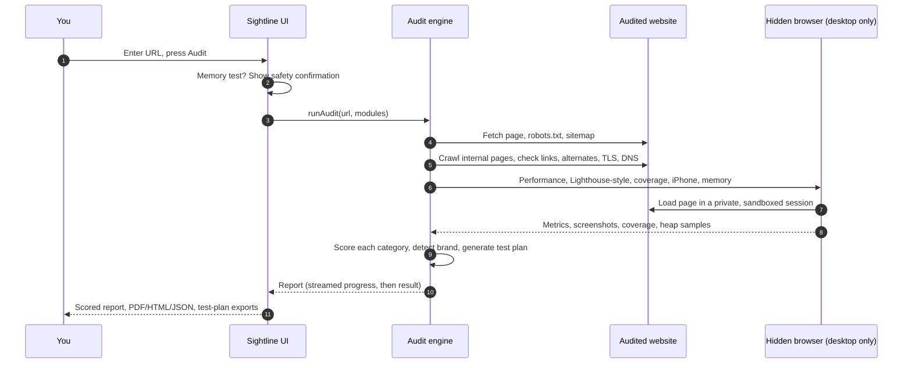
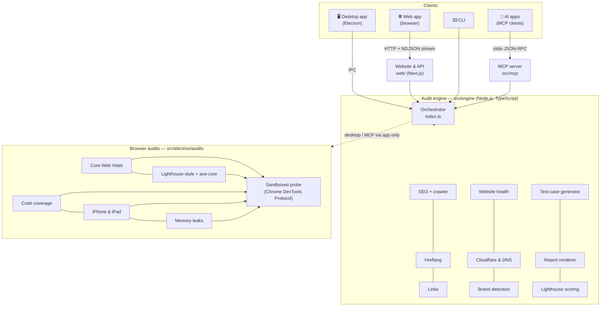

<div align="center">


# Sightline

**Every detail. Audited.**

A free, open-source **website audit tool** that runs an SEO audit, Lighthouse-style scores, Core Web Vitals, accessibility checks, a broken-link check, hreflang validation, JavaScript/CSS code coverage, **memory-leak detection**, iPhone/iOS Safari testing and a Cloudflare & DNS review — in **one click**, explained in plain language.

[](https://github.com/Zubair-hussain/Sightline/actions/workflows/ci.yml)
[](https://github.com/Zubair-hussain/Sightline/actions/workflows/codeql.yml)
[](LICENSE)


[Download](#-download) · [Features](#-what-sightline-checks) · [Architecture](#-system-architecture) · [MCP](#-ai-apps-mcp-server) · [CLI](#-command-line-interface) · [Discussions](https://github.com/Zubair-hussain/Sightline/discussions)


</div>

## Watch the intro

[Watch the 40-second Sightline intro video](https://github.com/Zubair-hussain/Sightline/blob/feat/social-preview/video/renders/sightline-intro.mp4) (720p MP4, 1.47 MB, with audio).

The editable video project, scenes and assets are in [`video/`](video/). To preview or render it locally:

```bash
cd video
npm run dev       # open the HyperFrames preview
npm run render    # render the video to MP4
```

See [`video/CREDITS.md`](video/CREDITS.md) for media credits.

---

## Table of contents

1. [What is Sightline?](#-what-is-sightline)
2. [Who it is for](#-who-it-is-for)
3. [What Sightline checks](#-what-sightline-checks)
4. [Download](#-download)
5. [Quick start](#-quick-start)
6. [How an audit works](#-how-an-audit-works)
7. [System architecture](#-system-architecture)
8. [Audit modules in depth](#-audit-modules-in-depth)
9. [Scoring methodology](#-scoring-methodology)
10. [Reports](#-reports)
11. [Launch-day test plan](#-launch-day-test-plan)
12. [Memory-leak test and safety](#-memory-leak-test-and-safety)
13. [AI apps (MCP server)](#-ai-apps-mcp-server)
14. [Command-line interface](#-command-line-interface)
15. [Web version and HTTP API](#-web-version-and-http-api)
16. [Security and privacy model](#-security-and-privacy-model)
17. [Deployment](#-deployment)
18. [Configuration reference](#-configuration-reference)
19. [Project structure](#-project-structure)
20. [Tech stack](#-tech-stack)
21. [How Sightline compares](#-how-sightline-compares)
22. [FAQ](#-faq)
23. [Roadmap](#-roadmap)
24. [Contributing](#-contributing)
25. [License](#license)

---

## 💡 What is Sightline?

Before a website goes live, teams usually juggle many separate tools: Lighthouse for speed, an SEO crawler, a broken-link checker, an hreflang validator, Chrome DevTools for memory and coverage, a real iPhone for Safari quirks, and the Cloudflare dashboard. Each tool speaks its own language, and none of them produce one report you can hand to a client.

**Sightline runs all of these audits together** and turns the results into one scored report. Every finding says **what is wrong, why it matters and how to fix it**, so marketers, founders, QA testers and developers can all act on it.

It ships as:

- 🖥 a **desktop app** for Windows, macOS and Linux (all 10 audits),
- 🌐 a **web app** that runs in any browser (5 server-side audits),
- ⌨️ a **command-line tool** for CI pipelines,
- 🤖 an **MCP server** so AI assistants and AI code editors can run audits for you.

## 👥 Who it is for

| You are… | Sightline helps you… |
|---|---|
| A **founder or marketer** launching a site | Get a plain-language checklist of what to fix before launch |
| An **agency or freelancer** | Hand clients a PDF report styled in *their* brand colours and logo |
| An **SEO specialist** | Audit titles, indexability, sitemaps, structured data and hreflang return tags |
| A **QA tester** | Generate a launch-day test plan with automated pass/fail evidence |
| A **front-end developer** | Find memory leaks, unused JavaScript/CSS, layout shifts and iOS Safari bugs |
| A **DevOps / platform engineer** | Verify TLS, security headers, Cloudflare caching and DNS security |

## 🔍 What Sightline checks

| Audit | Highlights | Where it runs |
|---|---|---|
| **Lighthouse-style scores** | Performance, Accessibility, Best Practices and SEO (0–100) on a throttled mobile or desktop profile, including Speed Index | Desktop |
| **SEO** | Title, meta description, headings, canonical, robots.txt, noindex, XML sitemap, JSON-LD, Open Graph, duplicate titles across a crawl | Desktop · Web · CLI |
| **Core Web Vitals** | LCP, FCP, CLS, TBT, TTFB, page weight, JavaScript size, console errors, failed requests | Desktop |
| **Code coverage** | Unused JavaScript and CSS per file, like the Chrome DevTools Coverage tab | Desktop |
| **Broken links** | Every `<a href>`: 404/5xx, redirect chains, empty and `javascript:` links, missing link text, unsafe `target=_blank` | Desktop · Web · CLI |
| **Hreflang** | ISO 639-1 / 3166-1 codes, `x-default`, self-reference, conflicts and **return tags** verified on every language version | Desktop · Web · CLI |
| **Memory leaks** | JS heap, DOM nodes, event listeners, timers and detached nodes across repeated use, behind a safety confirmation | Desktop |
| **iPhone & iPad** | iOS Safari emulation: 44 pt tap targets, input auto-zoom, safe areas, `100vh`, touch icon, Universal Links, device screenshot | Desktop |
| **Website health** | HTTPS, TLS expiry and version, HSTS, CSP, clickjacking, cookies, compression, caching, HTTP/3, mixed content, accessibility basics | Desktop · Web · CLI |
| **Cloudflare & DNS** | Proxy detection, edge caching, minimum TLS, origin-IP exposure, DNSSEC, CAA, SPF/DMARC, optional zone-settings review via API | Desktop · Web · CLI |

## ⬇️ Download

| Platform | Installer |
|---|---|
| **Windows 10/11** (x64, runs on ARM via emulation) | [`Sightline-Setup-x64.exe`](https://github.com/Zubair-hussain/Sightline/releases/latest/download/Sightline-Setup-x64.exe) |
| **macOS 11+** (universal: Apple Silicon M1–M4 and Intel) | [`Sightline-mac-universal.dmg`](https://github.com/Zubair-hussain/Sightline/releases/latest/download/Sightline-mac-universal.dmg) |
| **Linux** | [AppImage](https://github.com/Zubair-hussain/Sightline/releases/latest/download/Sightline-linux-x86_64.AppImage) · [.deb](https://github.com/Zubair-hussain/Sightline/releases/latest/download/Sightline-linux-amd64.deb) · [.rpm](https://github.com/Zubair-hussain/Sightline/releases/latest/download/Sightline-linux-x86_64.rpm) |

> Installers are not code-signed yet. On macOS, right-click the app → **Open** the first time. On Windows, choose **More info → Run anyway**. Signing is tracked in [#3](https://github.com/Zubair-hussain/Sightline/issues/3).

## 🚀 Quick start

**Desktop app** — install, type a website address, press **Audit**.

**From source**

```bash
git clone https://github.com/Zubair-hussain/Sightline.git
cd Sightline
npm install
npm start          # desktop app
npm run web        # website + web app (Next.js) on http://localhost:3000
```

**Command line**

```bash
npm run build
node out/cli/sightline.js example.com --html report.html --test-cases test-plan.csv
```

## ⚙️ How an audit works



Each module returns a list of **checks** — `pass`, `warn`, `fail` or `info` — with a detail, an optional list of affected items and a plain-language fix. Modules run with individual time limits, so one slow website feature never blocks the whole report.

## 🏗 System architecture



**Key design decisions**

- **One engine, four front ends.** The desktop app, web server, CLI and MCP server all call the same `runAudit()`, so results are identical everywhere.
- **Browser audits are pluggable.** The engine receives an optional `BrowserRunner`. The desktop app supplies one built on Electron's Chromium, so no separate Chrome install is needed. The CLI and web server run without it.
- **Every browser test runs in a throw-away session** — a hidden window with an in-memory partition, permissions denied, downloads and pop-ups blocked.
- **Streaming progress.** The web API streams newline-delimited JSON (`progress` events, then the `report`), and the desktop app uses IPC events.
- **Plain types shared everywhere.** `types/report.d.ts` defines `Report`, `Category`, `Check` and friends for every layer, including the UI.

## 🔬 Audit modules in depth

<details>
<summary><b>SEO</b> — <code>src/engine/seo.ts</code>, <code>site.ts</code></summary>

- Parses `robots.txt` (groups, `Allow`/`Disallow`, `*` and `$` wildcards, longest-match rule) and checks the page is crawlable.
- Discovers sitemaps from `robots.txt`, `/sitemap.xml` and `/sitemap_index.xml`, following sitemap indexes.
- Crawls internal pages breadth-first (configurable, default 15) to find duplicate titles and descriptions, broken pages and slow pages.
- On-page checks: title and description length, single H1, heading order, canonical, `noindex` (meta and `X-Robots-Tag`), `lang`, image `alt`, word count, Open Graph, Twitter card, JSON-LD validity and types, URL hygiene.
</details>

<details>
<summary><b>Hreflang</b> — <code>src/engine/hreflang.ts</code>, <code>iso.ts</code></summary>

- Reads annotations from HTML `<link>` tags, HTTP `Link` headers and sitemap `xhtml:link` entries.
- Validates every code against ISO 639-1 languages, ISO 3166-1 regions, script subtags and common mistakes (`en-UK` → `en-GB`, `jp` → `ja`, underscores).
- Detects conflicts, missing self-reference, missing `x-default`, relative URLs and tags inside `<body>`.
- Fetches each alternate and verifies it returns 200, **links back** (return tag), is self-canonical and declares a matching `<html lang>`.
</details>

<details>
<summary><b>Links</b> — <code>src/engine/links.ts</code></summary>

Checks every unique link (HEAD, falling back to GET), separating internal from external. Reports broken links, redirect chains, links that block bots, placeholder `#` and `javascript:` links, missing accessible text, generic "click here" anchors, `target=_blank` without `noopener`, and insecure `http://` links.
</details>

<details>
<summary><b>Website health & security</b> — <code>src/engine/website.ts</code></summary>

HTTP status and redirect chain, HTTPS and HTTP→HTTPS redirect, TLS certificate expiry and negotiated protocol, HSTS, CSP, `X-Content-Type-Options`, `Referrer-Policy`, `Permissions-Policy`, clickjacking protection, technology-version leaks, cookie flags, Brotli/gzip, `Cache-Control`, HTTP/3, time to first byte, doctype, charset, HTML size, render-blocking scripts, image dimensions, lazy loading, modern formats, mixed content, form labels and button names.
</details>

<details>
<summary><b>Cloudflare & DNS</b> — <code>src/engine/cloudflare.ts</code></summary>

Detects Cloudflare from `cf-ray`, IP ranges, nameservers and `/cdn-cgi/trace`. Checks crawler challenges, HTML and asset edge caching, whether TLS 1.0/1.1 are still accepted, TLS 1.3, Always Use HTTPS, HSTS, HTTP/3, Brotli/Zstandard, feature fingerprints (Rocket Loader, Email Obfuscation, Turnstile, APO), **origin-IP exposure** through sibling DNS records, DNSSEC, CAA, IPv6 and SPF/DMARC. With a read-only API token it also reviews SSL mode, development mode, security level, Early Hints and more.
</details>

<details>
<summary><b>Core Web Vitals</b> — <code>src/electron/audits/performance.ts</code></summary>

Loads the page in the bundled Chromium and records LCP, FCP, CLS and long tasks (TBT) through `PerformanceObserver`, plus every network response, console errors and a desktop screenshot. It also reads the site's computed brand colours and fonts for themed reports.
</details>

<details>
<summary><b>Lighthouse-style scores</b> — <code>src/electron/audits/lighthouse.ts</code>, <code>src/engine/lighthouse-score.ts</code></summary>

- **Throttling:** mobile uses a Moto G Power profile with slow-4G network (562.5 ms RTT, ~1.4 Mbps) and 4× CPU slowdown; desktop uses 40 ms RTT, 10 Mbps, no CPU slowdown.
- **Speed Index:** computed from screencast frames with the histogram-based visual-progress method.
- **Performance:** each metric is scored on Lighthouse's published log-normal curves and combined with Lighthouse's weights.
- **Accessibility:** runs **axe-core** (WCAG 2.0/2.1/2.2 A and AA plus best practices) inside the page.
- **Best Practices** and **SEO** use live-DOM checks (HTTPS, console errors, deprecated APIs, image aspect ratio and resolution, crawlable links, legible fonts, and more).

This is an independent implementation, so scores are close to Google Lighthouse but not guaranteed identical.
</details>

<details>
<summary><b>Code coverage</b> — <code>src/electron/audits/coverage.ts</code></summary>

Uses the DevTools Protocol's precise block coverage (`Profiler.takePreciseCoverage`) and CSS rule-usage tracking while the page loads and scrolls. Reports unused bytes per file, first-party versus third-party waste and oversized bundles. Code used only after clicks or on other pages counts as unused, so check before deleting.
</details>

<details>
<summary><b>iPhone & iPad</b> — <code>src/electron/audits/mobile.ts</code></summary>

Emulates iPhone 16 Pro (402×874, 3×) or iPad Air with the Safari user agent and touch input. Checks viewport and pinch-zoom, horizontal overflow, 44×44 pt tap targets (Apple Human Interface Guidelines), legible text, inputs under 16 px that trigger iOS auto-zoom, intrusive overlays, safe-area insets, `100vh`, `background-attachment: fixed`, inline autoplay video, apple-touch-icon, theme-color, web app manifest, Smart App Banner and `apple-app-site-association` (Universal Links).
</details>

## 📊 Scoring methodology

- **Check status → value:** `pass` = 1, `warn` = 0.5, `fail` = 0, `info` is not scored.
- **Category score** = weighted average of its checks × 100. Important checks carry more weight (for example, "indexable" weighs 3, "Twitter card" weighs 0.5).
- **Lighthouse-style category** = the average of its four scores.
- **Overall score** = weighted average of category scores: Lighthouse 3, SEO 3, Website 2.5, Performance 2.5, Links 2, Mobile 2, Cloudflare 1.5, Memory 1.5, Coverage 1, Hreflang 1.
- **Colour bands** follow Lighthouse: 90–100 good, 50–89 needs work, 0–49 poor. Every score is printed as a number, so colour is never the only signal.

**Lighthouse performance weights**

| Metric | Weight | Mobile p10 / median | Desktop p10 / median |
|---|---|---|---|
| First Contentful Paint | 10% | 1.8 s / 3.0 s | 0.93 s / 1.6 s |
| Speed Index | 10% | 3.4 s / 5.8 s | 1.3 s / 2.3 s |
| Largest Contentful Paint | 25% | 2.5 s / 4.0 s | 1.2 s / 2.4 s |
| Total Blocking Time | 30% | 200 ms / 600 ms | 150 ms / 350 ms |
| Cumulative Layout Shift | 25% | 0.1 / 0.25 | 0.1 / 0.25 |

## 📄 Reports

Exports: **PDF**, **HTML** and **JSON**. By default reports are styled like the **audited website**: Sightline detects its brand colour (from the live page, CSS variables, buttons or `theme-color`), fonts and logo, adjusts colours for readable contrast, and builds:

1. a branded cover page with the overall score,
2. a summary with every category score and **"Fix these first"**,
3. desktop and iPhone screenshots (plus a live iframe preview in HTML when the site allows framing),
4. every category with its findings, Lighthouse gauges, coverage table and memory chart,
5. the launch-day test plan.

Switch to the neutral house style in **Settings → Report style**.

## ✅ Launch-day test plan

Every audit generates about 40 test cases across SEO, links, security, performance, accessibility, mobile, infrastructure and business-critical flows. Each has an ID, priority (P0–P2), steps, expected result and status.

- **Automated cases** are linked to audit checks and get pass/fail with quoted evidence.
- **Manual cases** cover what software can't confirm: forms and emails, payments in test mode, analytics and consent, keyboard-only use, screen readers, real devices, backups and rollback.
- Update statuses and notes in the app, then export to **Excel/CSV**, **Markdown** or a runnable **Playwright** test suite (TypeScript, with `@axe-core/playwright`).

## 🧠 Memory-leak test and safety

The memory test uses the website like a visitor, many times in a row, and measures memory after forced garbage collection each round. A page that leaks gets slower the longer it's used and eventually crashes the tab — especially on phones.

**Automatic mode (default):** scroll, resize, open and close menus and accordions, press Escape, and — when in-app navigation is detected — visit up to three internal pages and come back.

**Your own steps:** click, go to an in-app page, go back, type, press a key, scroll and wait, using CSS selectors.

**Safety, enforced in code**

- A confirmation screen lists exactly what will happen, what never will, and an estimate of the traffic. Nothing runs until you confirm you own the site or have permission. The desktop app's main process enforces this too.
- Never clicks controls inside forms, or anything labelled buy, pay, delete, submit, log out and similar; never follows links to other websites; blocks Enter inside forms.
- Runs in a private, empty session: no logins or cookies, downloads and pop-ups blocked, camera/microphone/location denied.
- Risky custom steps are flagged before you run them.
- Through MCP, AI apps must pass `i_have_permission: true` after asking you.

## 🤖 AI apps (MCP server)

Sightline implements the **Model Context Protocol**, so MCP-compatible AI assistants and code editors (for example Cursor and VS Code) can run audits on request.

**Setup:** open **Settings → Connect AI apps** in the desktop app and copy the snippet into your AI app's MCP configuration:

```json
{
  "mcpServers": {
    "sightline": {
      "command": "/Applications/Sightline.app/Contents/MacOS/Sightline",
      "args": ["--mcp"]
    }
  }
}
```

Without the desktop app, `node out/mcp/stdio.js` runs the five server-side audits.

| Tool | What it does |
|---|---|
| `audit_website` | Full audit with selectable modules; returns a scored Markdown report |
| `generate_test_cases` | Launch-day test plan as Markdown, CSV or Playwright |
| `check_lighthouse` | Lighthouse-style scores (mobile or desktop) |
| `check_seo` | SEO audit |
| `check_links` | Broken link check |
| `check_hreflang` | Hreflang validation |
| `check_security` | Website health and security headers |
| `check_cloudflare` | Cloudflare and DNS review |
| `check_performance` | Core Web Vitals |
| `check_coverage` | Unused JavaScript and CSS |
| `check_mobile_ios` | iPhone/iPad Safari audit |
| `check_memory_leaks` | Memory-leak test (requires `i_have_permission`) |

Example prompts: *"Audit example.com and tell me what to fix first"*, *"Generate a launch-day test plan for example.com as CSV"*, *"Check example.com for memory leaks"*.

## ⌨️ Command-line interface

```text
sightline <url> [options]

  --modules <list>     seo,hreflang,links,website,cloudflare  (default: all)
  --pages <n>          Pages to crawl for site-wide SEO checks (default 15)
  --links <n>          Maximum links to status-check (default 150)
  --json <file>        Full report as JSON
  --html <file>        Standalone HTML report (styled like the audited site)
  --test-cases <file>  Test plan: .csv (Excel), .md, or .spec.ts (Playwright)
  --fail-under <n>     Exit with code 1 when the overall score is below n
  --quiet              Only print the final score
```

**GitHub Actions example**

```yaml
- uses: actions/checkout@v4
  with: { repository: Zubair-hussain/Sightline, path: sightline }
- run: cd sightline && npm ci && npm run build
  env: { ELECTRON_SKIP_BINARY_DOWNLOAD: '1' }
- run: node sightline/out/cli/sightline.js https://your-site.com --fail-under 80 --html report.html
```

## 🌐 Web version and HTTP API

The website is a **Next.js (App Router)** app in `web/`. The landing page is pre-rendered to static HTML with full SEO metadata, Open Graph cards and `SoftwareApplication` + `FAQPage` structured data. The API routes call the shared audit engine directly, and `/app` serves the same UI as the desktop app, wired to the API through a web bridge.

```bash
npm run web          # dev server on http://localhost:3000
npm run web:build    # production build
```

| Route | Purpose |
|---|---|
| `GET /` | Landing page with OS-aware download buttons |
| `GET /app` | The Sightline UI in the browser |
| `GET /robots.txt` · `/sitemap.xml` · `/llms.txt` | Search-engine and AI-assistant discovery |
| `POST /api/audit` | `{ "url": "...", "modules": [...] }` → NDJSON stream of `progress` events, then `report` |
| `POST /api/report-html` | `{ report, theme, target }` → standalone HTML report |
| `POST /api/testcases` | `{ report, cases, format }` → CSV, Markdown or Playwright file |
| `GET /api/config` | Version and installer availability |
| `GET /download/:platform` | `windows`, `mac`, `linux`, `linux-deb`, `linux-rpm` |
| `GET /healthz` | Health check |

## 🔒 Security and privacy model

| Risk | Protection |
|---|---|
| **SSRF** (public server fetching internal addresses) | Every request and redirect hop resolves DNS and rejects loopback, private, link-local, CGNAT, cloud-metadata and reserved ranges, internal hostnames and unusual ports |
| **Audited content injecting code** | The UI renders site text as text nodes only; reports escape all values; PDF rendering runs with JavaScript disabled |
| **Browser tests touching accounts** | In-memory session per test, no cookies, permissions denied, downloads and pop-ups blocked |
| **Abuse of the public server** | Per-IP hourly rate limit and a concurrency cap |
| **Secrets** | The Cloudflare token is stored encrypted with the OS keychain (`safeStorage`) and never written in plain text |
| **Clickjacking and sniffing** | The website sends `X-Frame-Options: DENY`, HSTS, `nosniff`, a strict referrer policy and hides `X-Powered-By` |

Desktop audits run entirely on your computer. The web version fetches the audited page from the server and does not store reports — history stays in your browser. Report vulnerabilities privately via [SECURITY.md](SECURITY.md).

## 🚢 Deployment

**Desktop installers** — push a tag like `v1.0.0`. The **Build & release installers** workflow builds Windows, macOS and Linux installers and publishes them to a GitHub Release.

**Website / web app**

| Option | How |
|---|---|
| **Vercel** (recommended) | Import the repo, set **Root Directory** to `web`, keep "Include files outside the root directory" on, and set `NEXT_PUBLIC_SITE_URL`. Audits run as Node.js functions (60 s limit) |
| Docker | `docker run -p 8080:8080 ghcr.io/zubair-hussain/sightline:latest` (Next.js standalone image built by the **Website Docker image** workflow) |
| Render | One-click via `render.yaml`; add a `RENDER_DEPLOY_HOOK` secret to redeploy on every push |
| Any VPS / Fly.io / Railway | Use the `Dockerfile`, expose port 8080, set `SIGHTLINE_TRUST_PROXY=1` behind a proxy |

> On serverless hosts each instance keeps its own rate-limit window. For strict limits under heavy traffic, put the site behind a CDN rule or a shared store.

## 🧩 Configuration reference

| Variable | Default | Purpose |
|---|---|---|
| `NEXT_PUBLIC_SITE_URL` | `http://localhost:3000` | Public URL of the website (canonical links, sitemap, social cards) — set at build time |
| `PORT` | `3000` (Docker: `8080`) | Web server port |
| `SIGHTLINE_RELEASES_URL` | this repo's latest release | Where download buttons point |
| `SIGHTLINE_RATE_PER_HOUR` | `20` | Web audits per IP per hour |
| `SIGHTLINE_MAX_CONCURRENT` | `3` | Simultaneous web audits per instance |
| `SIGHTLINE_MAX_PAGES` · `SIGHTLINE_MAX_LINKS` | `6` · `60` | Crawl and link-check limits on the website |
| `SIGHTLINE_TRUST_PROXY` | auto on Vercel | Use `X-Forwarded-For` for client IPs behind a proxy |
| `CLOUDFLARE_API_TOKEN` | — | CLI/MCP: read-only token for zone-settings review |

Desktop settings (language, appearance, report style, crawl and link limits, Lighthouse device, iPhone/iPad, memory steps, allowed sites, Cloudflare token) are in the app's **Settings**.

## 📁 Project structure

```text
src/
  engine/            Audit engine shared by every front end
    index.ts         Orchestrator: modules, timeouts, overall score, brand, test plan
    seo.ts site.ts   SEO audit, robots.txt, sitemaps, crawler
    hreflang.ts iso.ts   Hreflang validation
    links.ts         Broken link checker
    website.ts       HTTPS, TLS, headers, page health
    cloudflare.ts    Cloudflare & DNS
    brand.ts         Brand colour, font and logo detection
    lighthouse-score.ts  Lighthouse scoring curves and Speed Index
    testcases.ts     Launch-day test plan and exports
    report-html.ts   PDF/HTML report
    public-guard.ts  SSRF protection and rate limiting for public servers
  electron/          Desktop app, sandboxed probe, browser audits
  tools/             Icon generator
  mcp/               MCP server
  cli/               Command-line interface
renderer/            UI (HTML, CSS, TypeScript)
web/                 Website, browser app and HTTP API (Next.js App Router)
  app/               Landing page, layout/metadata, robots, sitemap, API and download routes
  components/        Client components: hero form, OS-aware downloads, MCP snippet
  lib/               Page content and server helpers (guard, rate limit, limits)
  scripts/           Copies the shared UI into public/app at build time
types/               Shared types
.github/workflows/   CI, CodeQL, Docker, releases
```

## 🧰 Tech stack

TypeScript (strict) · Electron · Next.js 15 (App Router) + React 19 for the website · Chrome DevTools Protocol · Node.js · cheerio · axe-core · Model Context Protocol · Docker · GitHub Actions. The app UI itself uses no framework: it is plain TypeScript with an Apple-inspired design system, light and dark modes, and 14 languages (English, Español, Français, Deutsch, Português, Italiano, Русский, Türkçe, العربية, اردو, हिन्दी, 简体中文, 日本語, 한국어).

## ⚖️ How Sightline compares

| Need | Usual tool | Sightline |
|---|---|---|
| Lighthouse scores | Lighthouse / PageSpeed Insights | ✅ Lighthouse-style scores with the same curves and axe-core |
| Site SEO crawl | Desktop SEO crawlers | ✅ Focused crawl with duplicate and status checks |
| Hreflang return tags | Dedicated hreflang checkers | ✅ Built in |
| Memory leaks | DevTools heap snapshots by hand | ✅ Automated, with safety rules |
| Unused JS/CSS | DevTools Coverage tab | ✅ Built in, per file |
| iOS Safari issues | A real iPhone | ✅ Emulation plus iOS-specific checks (real-device check still recommended) |
| Cloudflare review | Cloudflare dashboard | ✅ External checks plus optional API review |
| Client report | Manual slides | ✅ Branded PDF with test plan |
| AI assistant integration | — | ✅ MCP server |

Sightline is not a replacement for deep enterprise crawls of very large sites or for testing on real devices; it is designed to catch launch blockers fast.

## ❓ FAQ

**Is Sightline free?** Yes — MIT-licensed, no account. The public web version has a fair-use hourly limit.

**Do I need to code?** No. Type a website address and press Audit; every finding explains itself.

**Does it work on a MacBook?** Yes, natively on Apple Silicon and Intel with macOS 11 or later.

**Why do some audits need the desktop app?** Performance, Lighthouse-style, coverage, iPhone and memory tests must load the page in a real browser engine, which the desktop app bundles.

**Are the scores identical to Google Lighthouse?** They use Lighthouse's published scoring curves and the same accessibility engine, but it is an independent implementation, so expect close — not identical — numbers.

**Can it audit localhost, staging or pages behind a login?** Localhost and staging: yes, in the desktop app. Logged-in pages are on the [roadmap](https://github.com/Zubair-hussain/Sightline/issues/6).

**Will the memory test buy something or submit a form?** No — see [Memory-leak test and safety](#-memory-leak-test-and-safety).

## 🗺 Roadmap

- [Batch audits from a sitemap or URL list](https://github.com/Zubair-hussain/Sightline/issues/1)
- [Translated audit findings](https://github.com/Zubair-hussain/Sightline/issues/2)
- [Code-signed installers](https://github.com/Zubair-hussain/Sightline/issues/3)
- [Scheduled audits and score history](https://github.com/Zubair-hussain/Sightline/issues/4)
- [Optional Google Lighthouse engine](https://github.com/Zubair-hussain/Sightline/issues/5)
- [Audits behind a login](https://github.com/Zubair-hussain/Sightline/issues/6)

Ideas welcome in [Discussions](https://github.com/Zubair-hussain/Sightline/discussions).

## 🤝 Contributing

Contributions of all sizes are welcome — new checks, fixes, translations and docs. Start with [CONTRIBUTING.md](CONTRIBUTING.md), look for [`good first issue`](https://github.com/Zubair-hussain/Sightline/issues?q=is%3Aissue+is%3Aopen+label%3A%22good+first+issue%22), and follow the [Code of Conduct](CODE_OF_CONDUCT.md).

If Sightline saved you time, **⭐ star the repository** so others can find it.

## License

[MIT](LICENSE) © Zubair Hussain.

Lighthouse is a trademark of Google LLC. Sightline is an independent project and is not affiliated with or endorsed by Google, Apple or Cloudflare.
