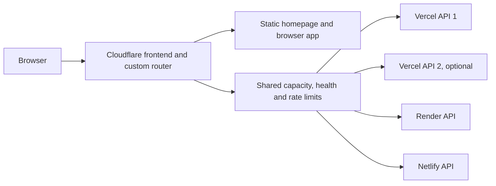

# Cloudflare frontend with interchangeable Node API replicas

The public hostname serves the existing Sightline homepage and browser app from Cloudflare Worker static assets. A custom Worker and Durable Object route the API; this does **not** use Cloudflare Load Balancing. Vercel, Render and Netlify run the same Next.js audit handlers and reject frontend routes when `SIGHTLINE_API_ONLY=1`.



## What the router does

- Weighted least-connections routing with configurable capacity per replica. Full replicas return a short retry response rather than accepting an unlimited queue. Capacity here is per configured deployment, across the entire router, not a promise that the hosting service provisions a particular number of processes.
- Shared, persistent per-IP token buckets: by default, up to 20 audits in a burst, refilling over an hour. Only a SHA-256 digest of the IP and bucket counters are stored, never URLs or reports. Inactive buckets are removed after an hour. Origin-instance limits remain as a second layer.
- Readiness probes every five minutes, with on-demand refresh after 30 seconds and a cooldown after failures. Only a successful Sightline `/healthz` response counts as ready. A degraded edge health response remains HTTP 200 if any replica is available; HTTP 503 means none is ready. Overloaded but ready replicas may also produce HTTP 503 on audit requests.
- Raw NDJSON streaming. A stream occupies its slot until it finishes, errors or is cancelled. Accepted audits are never cached or replayed. The router retries a busy audit on another origin only when the origin explicitly says the audit has not started; it does not retry ambiguous network failures. Safe configuration GET requests can fail over after network errors or 502/503/504 responses.
- Immutable caching for Next's hashed JS/CSS, revalidation for HTML and the shared browser UI, and a 60-second cache for public `/api/config`. Audit results and exports are `no-store`.
- An origin secret injected by the router, along with the Cloudflare-provided client IP. Unauthenticated API calls to replicas fail closed. The secret is not exposed to browser JavaScript. `/healthz` remains public and contains no secrets.

One Durable Object coordinates this installation. It adds an edge-to-coordinator hop and is a shared throughput boundary; this setup is suitable for an initial deployment, not unlimited global scale. Load balancing distributes available capacity; provider quotas and concurrency limits still apply. For much larger scale, partition coordination or use a job queue with workers and result storage.

## 1. Deploy the backend replicas

Use the **same Git commit** on every host. Set the following runtime variables on all replicas:

| Variable | Value |
| --- | --- |
| `SIGHTLINE_API_ONLY` | `1` |
| `SIGHTLINE_ORIGIN_SECRET` | The same newly generated random secret on each origin and the Worker |
| `SIGHTLINE_TRUST_PROXY` | `1` |
| `SIGHTLINE_MAX_CONCURRENT` | `3` initially; align the router's `maxInFlight` with the capacity you want |
| `SIGHTLINE_MAX_PAGES` | `6` initially |
| `SIGHTLINE_MAX_LINKS` | `60` initially |

Generate the secret in your password manager and enter it through each provider's secret settings. Do not commit it. Custom public URLs can be set as `NEXT_PUBLIC_SITE_URL` at build time; they should point to the Cloudflare frontend, not the replica.

### Vercel (one or two replicas)

Import `Zubair-hussain/Sightline`, select the deployment branch, use the Next.js preset and **Root Directory `web`**, and enable access to files outside the root. `web/vercel.json` supplies the build command. Configure the variables above and deploy. To add another Vercel replica, create a second project using exactly the same source and settings.

Production deployment protection must allow the router's requests. If you protect the origin with Vercel's deployment protection, configure an approved bypass before putting it in the pool; the Sightline origin secret does not bypass Vercel's own protection. Check that `/healthz` returns the readiness JSON, rather than a login page.

### Render

Use the repository's `render.yaml` Blueprint or its Dockerfile. Enter the shared secret when prompted. Render uses `/healthz` for deployment health checks; Docker's health check follows the actual `PORT`.

The Blueprint retains the existing **free** plan; this change does not purchase paid hosting. The five-minute external probes generate inbound requests, but cannot guarantee availability or prevent suspension. Render's own health checks are not a no-sleep feature. An always-on paid instance is needed if you require a no-sleep guarantee. Free services share a monthly instance-hour allowance, so keeping multiple instances awake can exhaust it. See [Render's free-service limits](https://render.com/docs/free).

### Netlify

Import the repository with root-level `netlify.toml`. It builds `web` from the repository root and publishes `web/.next`, avoiding legacy base-directory resolution differences. The pinned Next.js adapter is installed from the root package. Set **all variables in the table above** in Netlify's environment settings: configuration-file environment variables alone do not reach deployed functions. On the free plan use default scopes; granular scopes and some secret flags require plan features. Confirm the published `/healthz` endpoint and direct-API rejection before adding this replica.

Audits use the same five server-side modules everywhere. The desktop-only browser modules remain desktop-only. Serverless execution time and request-size limits still apply: the audit route declares a 60-second Vercel duration; check your provider's actual limits and test a representative public-site audit before launch. Slow third-party sites can exceed serverless limits; prefer Render for those workloads. The router does not migrate a partially completed audit between hosts.

## 2. Configure Cloudflare

```powershell
npm ci --prefix web
npm ci --prefix deploy/cloudflare
cd deploy/cloudflare
npx wrangler login
npx wrangler whoami
```

Create/use your Cloudflare Workers subdomain in the dashboard. The initial address will be `https://sightline.<your-subdomain>.workers.dev`. Set the real public URL for the frontend build:

```powershell
$env:NEXT_PUBLIC_SITE_URL = 'https://sightline.YOUR-SUBDOMAIN.workers.dev'
```

In `wrangler.jsonc`, replace `BACKENDS: "[]"` with a JSON-encoded array of your actual deployed **HTTPS origins**, for example:

```json
[
  { "name": "vercel-1", "url": "https://YOUR-API-1.vercel.app", "weight": 1, "maxInFlight": 3 },
  { "name": "vercel-2", "url": "https://YOUR-API-2.vercel.app", "weight": 1, "maxInFlight": 3 },
  { "name": "render", "url": "https://YOUR-API.onrender.com", "weight": 1, "maxInFlight": 3 },
  { "name": "netlify", "url": "https://YOUR-API.netlify.app", "weight": 1, "maxInFlight": 3 }
]
```

Only list actual healthy deployments; omit the optional second Vercel project until it exists. Origins must have no path, credentials, query string or fragment. Never put the public Cloudflare hostname into its own backend pool. Higher weights send a larger share of traffic to that replica, subject to its hard capacity limit.

`BACKENDS` is a JSON string in Wrangler's `vars` object, not a nested array. An empty array intentionally disables API traffic until real origins are configured. Review `RATE_PER_HOUR`, `HEALTH_TIMEOUT_MS`, `HEADER_TIMEOUT_MS`, `HEALTH_TTL_MS` and `FAILURE_COOLDOWN_MS` in that file. Header timeout ends after the upstream headers arrive; it is not a deadline on a healthy audit stream.

Set the origin key through Wrangler's hidden interactive prompt:

```powershell
npx wrangler secret put ORIGIN_SECRET
npm test
npm run build
npm run check
npm run deploy
```

The frontend packager reuses the existing Next.js build's pre-rendered homepage, not a separate design. It validates the expected output locations before copying. Cloudflare uploads only the static files and the custom router, with no Node audit engine or backend frontend. The initial `workers.dev` address and canonical URL must match. Run `wrangler tail` to inspect deployment errors; never log secrets or audit payloads.

## 3. Verify the live deployment

- `/` shows the landing page; `/app?url=example.com` opens the browser audit UI.
- `/healthz` shows the configured/available replica count. `/api/config` works through Cloudflare.
- A representative `/api/audit` streams progress and ends with a report; exports still work.
- Each replica returns HTTP 404 for `/`, `/app/` and frontend asset paths, HTTP 401 for an API request without the origin key, and HTTP 200 readiness at `/healthz`.
- Take one origin out of the pool or stop it, let the health TTL expire, and confirm new requests use another healthy origin. Do not test by interrupting an accepted audit and expecting it to resume elsewhere.

The router caps export request bodies at 4,000,000 bytes to fit the smallest backend payload limit. Very large report exports should use the desktop app. Tests cover routing, streams, limits, failure handling, secret forwarding and frontend separation. CI builds the frontend, validates the Worker bundle, and smoke-tests backend isolation.

Deployment still requires your hosting accounts and actual replica URLs. A successful local build or Git push alone does not publish this infrastructure.
